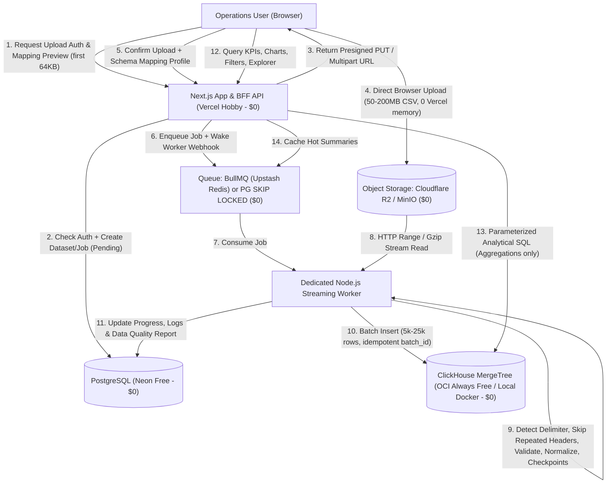
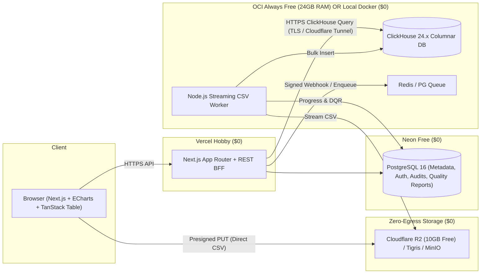

# Telecom QoS Intelligence & MediaCore CSV Analytics Platform — Technical Blueprint

> **Status:** Phase 1 Complete (Architecture & Planning) -> Phase 2 Foundation Active  
> **Budget Constraint:** **\$0/month Free-Tier Deployment Ready** (Zero paid plans or subscriptions required)  
> **Empirical Baseline:** Verified against workspace real export [`xdr_all_tps.csv`](../xdr_all_tps.csv) (157.9 MB, 539,048 data rows + 24 embedded headers, `;`-delimited, 27 columns, 24h traffic on `2026-11-13`)

---

## A. Understanding of the Business Problem

Operations teams running SMS aggregation and wholesale routing on **MediaCore** generate daily XDR/CDR CSV exports containing **2M–10M records** (typically **50 MB–200+ MB**, or larger when verbose 27-column exports like `xdr_all_tps.csv` are downloaded). Manual spreadsheet filtering breaks down completely at this scale: spreadsheets crash or silently truncate rows, multi-dimensional root-cause isolation is slow, and percentage calculations across overlapping statuses are error-prone.

### Empirical Insights from Real MediaCore Export (`xdr_all_tps.csv`)

Streaming analysis of the actual sample export in this workspace uncovered critical domain behaviors that **must** shape our ingestion and metric engines:

1. **Semicolon Delimiter & Embedded Repeated Headers:** The file uses `;` delimiters and contains **23 repeated header rows mid-file** (`OP Name;TP Name;Send Time...` appearing 24 times total across 539,072 lines) caused by concatenated chunked exports. A naive CSV parser would either crash on timestamp parsing or count headers as corrupted records.
2. **Dual Outcome Columns (`Status` vs `State`):**
   - When a Termination Provider (**TP**) **rejects at submission (`submit_sm_resp`)**, MediaCore writes the SMPP numeric error code into `Status` (`69` = 221,791 rows; `11` = 106,646 rows; `88` = 692 rows) and leaves `State`, `DLR time`, `Message ID`, and `Cost OUT` **empty**.
   - When a TP **accepts** the message, `Status` is **empty** (`209,919` rows) and the downstream Delivery Receipt (**DLR**) populates `State` (`DELIVRD` = 209,559; `UNDELIV` = 143; `ENROUTE` = 139; `REJECTD` = 55; `EXPIRED` = 9; blank = 14), `DLR time`, `Message ID`, and `Cost OUT`.
   - **Critical Rule:** Submit-stage failures (`Status != ''`) and DLR-stage outcomes (`State`) are mutually exclusive stages of a message lifecycle and must be unified cleanly without double-counting.
3. **Multi-Leg Failover / LCR Hunting Attempts:** Examining consecutive rows (e.g., `2026-11-13 00:00:00.175370` -> `.229904` -> `02.236069` for `Clear Number = 989115858774`) shows MediaCore routing a single OP SMS across multiple TPs sequentially when earlier TPs return `Status = 69` or `11`. Deduplication must **only** eliminate identical repeated rows (`row_hash` duplicates), never legitimate failover routing legs to different TPs.
4. **Geographic Representation Nuances:** `Country` contains network-enriched names when `TP MNC` resolves (e.g., `Cote Divoire mobile Orange CI`) and bare country names when `TP MNC` is blank (e.g., `Cote d'Ivoire (Ivory Coast)`, `Iran`). Storing **both** raw network label (`raw_country_network`) and canonical country derived unambiguously from `OP MCC` / `TP MCC` / exact mapping preserves MNO granularity without distorting country rollups.
5. **Financial & Routing Context Available:** Columns like `Dialpeer` (Route), `OP Price`, `TP Price`, `Cost IN`, `Cost OUT`, `OP Host`, `TP Host`, `NAS IP`, and `DLR time` enable latency (`DLR time - Send Time`) and margin/unbilled-submit diagnostics alongside QoS metrics.

### Core Business Questions Answered

- **WHAT is failing?** Terminal delivery vs submit-rejection breakdown across raw and normalized status categories.
- **WHERE is it failing?** Canonical Country, Mobile Network (`MCC/MNC`), `Dialpeer` route, and Host IP (`OP Host` / `TP Host`).
- **WHO is responsible?** Distinct `OP Name` (Originating Partner / Customer), `TP Name` (Termination Provider / Vendor), `Applicant`, `OP ANI`, and `TP ANI` — never conflating TP with Applicant.
- **WHY is it failing?** Technical SMPP error codes (`Status`), DLR `State`, and `Message Reason` ranked by failure volume and failure contribution %.
- **WHEN did degradation begin?** Microsecond-accurate `Send Time` hourly/15-min series with baseline anomaly detection and minimum sample-size guards.

---

## B. Recommended Final Architecture (100% Free-Tier Deployable)

To deliver enterprise ClickHouse speed + streaming worker reliability with **zero paid subscriptions (\$0/month)**, the system uses a **decoupled 3-tier architecture** with clean adapter interfaces so the exact same codebase runs on:

1. **Local Self-Hosted Docker Stack (\$0/mo):** ClickHouse + PostgreSQL + Redis + MinIO running locally via `docker compose up -d`.
2. **Cloud \$0-Forever Topology A (Full Managed + Oracle Always Free):**
   - **Frontend & Light BFF APIs:** **Vercel Hobby** (\$0, no card, 100 GB bandwidth).
   - **Application Metadata DB:** **Neon Serverless PostgreSQL Free** (\$0, no card, 1 GB storage, 100 CU-hrs/mo).
   - **Object Storage:** **Cloudflare R2 Free Tier** (\$0 up to 10 GB storage, 1M Class A, 10M Class B, \$0 egress; gzip-compressed raw exports keep ~300+ days within 10 GB) or **Tigris Free** (5 GB, no card) / **MinIO** on OCI.
   - **Analytical DB + Dedicated Streaming Worker:** **Oracle Cloud Infrastructure (OCI) Always Free Ampere A1** (up to 4 OCPUs, **24 GB RAM**, **200 GB Block Storage**, \$0 forever) running Dockerized **ClickHouse Server** + **Node.js Ingestion Worker** behind TLS/Cloudflare Tunnel.
   - **Queue / Cache:** **Upstash Redis Free** (\$0, no card, 500K commands/mo) **OR** built-in **PostgreSQL `FOR UPDATE SKIP LOCKED` Job Queue** mode (zero Redis idle-polling overhead so 500K Upstash commands are never exhausted).
3. **Cloud \$0-Forever Topology B (Cardless Hybrid — No OCI Card Needed):**
   - Vercel Hobby + Neon PostgreSQL Free + Tigris/R2 + **Render Free Web Service** (Node.js worker woken on-demand by signed webhook on upload completion, streaming with small 2,500-row batches to stay within 512 MB RAM) + **ClickHouse via Cloudflare Tunnel (`cloudflared`)** on your own always-on PC/server (or Tinybird Free 10 GB tier via query adapter).

> **Important Truthfulness Note on Managed Trials:** ClickHouse Cloud (30-day \$300 trial), Railway (\$5 one-time trial), and Fly.io do **not** offer permanent \$0 tiers. Therefore, we explicitly avoid relying on expiring trials and build directly around permanent \$0 infrastructure + Docker portability.

---

## C. System Architecture Diagrams

### 1. End-to-End Ingestion & Analytics Pipeline

### 2. Free-Tier Deployment Topology

---

## D. Complete Technology Stack & Reasoning

| Layer | Technology | Selection Reasoning |
|---|---|---|
| **Frontend** | Next.js (App Router), TypeScript, Tailwind CSS, shadcn/ui, Lucide React | Enterprise-grade SSR/CSR, strict type safety, clean composable minimal UI primitives, \$0 deployment on Vercel Hobby. |
| **Visualizations & Tables** | Apache ECharts, TanStack Query, TanStack Table, React Hook Form + Zod | ECharts handles high-density time series, heatmaps, and geo maps cleanly without lag; TanStack Table handles server-side sorting/pagination without loading 10M rows in DOM. |
| **Backend BFF** | Next.js Route Handlers + Zod + Node.js REST API | Fast schema validation, strict parameterization, RBAC guardrails, zero DB credentials exposed to browser. |
| **Object Storage** | Cloudflare R2 (or S3-compatible MinIO / Tigris) | Direct presigned PUT/multipart bypasses Vercel's 4.5 MB request body limit and 10–60s timeout; \$0 egress on R2. |
| **Analytical DB** | ClickHouse (`MergeTree` + `SummingMergeTree` MVs) | Columnar compression (~8–12x on MediaCore XDRs), sub-second `GROUP BY` and multi-filter slicing over 2M–10M+ records. |
| **Application DB** | PostgreSQL 16 (Neon Free / Docker) | ACID integrity for RBAC, datasets, job checkpoints, schema profiles, status classification rules, saved filters, audit logs, and notes. |
| **Background Queue & Worker** | Node.js Worker + `csv-parse` stream + Dual Queue (`BullMQ/Redis` or `PG SKIP LOCKED`) | Bounded-memory streaming (`<150 MB` RSS even for 200+ MB files), crash-safe batch checkpoints, zero Upstash polling burn when using PG queue mode. |

---

## E. Database Design

Full SQL migrations are versioned in:
- [`database/postgres/001_initial_schema.sql`](../database/postgres/001_initial_schema.sql)
- [`database/clickhouse/001_initial_schema.sql`](../database/clickhouse/001_initial_schema.sql)

### 1. PostgreSQL Application Tables (16 Tables)

1. `users` — Accounts, bcrypt/Argon2 password hash, `is_active`, `mask_pii_default`.
2. `roles` & `user_roles` — `admin`, `analyst`, `operator`, `viewer` RBAC permissions.
3. `datasets` — Canonical dataset entity (`id`, `name`, `source_type`, `status`, `coverage_start`, `coverage_end`, `total_rows`, `valid_rows`, `invalid_rows`, `duplicate_rows`, `skipped_rows`, `schema_profile_id`, `retention_status`).
4. `upload_jobs` — Presigned upload & worker lifecycle (`id`, `dataset_id`, `idempotency_key`, `storage_key`, `file_name`, `file_size_bytes`, `file_sha256`, `stage` [1..12], `progress_pct`, `checkpoint_row_offset`, `checkpoint_batch_index`, `attempt_count`, `started_at`, `completed_at`, `duration_ms`, `error_code`, `error_message`).
5. `schema_profiles` & `schema_mappings` — Saved header-to-logical-field mapping profiles (`delimiter`, `has_header`, `column_mappings` JSONB, `alias` rules).
6. `status_classification_rules` — Configurable mapping of `(raw_submit_status, raw_dlr_state)` -> `normalized_status` (`SUCCESS`, `FAILED`, `REJECTED`, `PENDING`, `OTHER`, `UNKNOWN`) + `is_terminal` flag.
7. `processing_logs` — Structured stage-by-stage worker logs (`level`, `stage`, `message`, `metadata`).
8. `data_quality_reports` — Per-upload DQ summary + `error_report_storage_key` (downloadable CSV of malformed rows).
9. `saved_filters` — Named filter presets and shareable filter hashes.
10. `audit_logs` — Immutable trail of logins, uploads, schema edits, dataset deletions, and exports.
11. `user_preferences` — Persisted Light/Dark theme, default dataset selection, PII masking preference, timezone.
12. `alert_configurations` & `degradation_alerts` — Thresholds (`min_sample_size`, `failure_rate_delta_pct`, `z_score_threshold`) and triggered alerts.
13. `investigation_notes` — Team collaboration annotations linked to dataset + dimension filters.
14. `report_exports` — Async export jobs (`CSV`/`XLSX`/`PDF`) with time-limited presigned download keys.

### 2. ClickHouse Analytical Schema

- **`sms_records` (`MergeTree`)**:
  - **Partitioning:** `PARTITION BY toYYYYMM(event_timestamp)` — keeps daily/monthly partitions balanced without creating thousands of tiny parts.
  - **Sorting Key / Primary Index:** `ORDER BY (dataset_id, toDate(event_timestamp), op_name, tp_name, normalized_status, country, event_timestamp, message_row_id)` — accelerates 95% of dashboard queries filtering by dataset + date + OP/TP/status/country.
  - **Column Optimization:** `LowCardinality(String)` for `op_name`, `tp_name`, `country`, `raw_country_network`, `raw_submit_status`, `raw_dlr_state`, `raw_status`, `normalized_status`, `reason`, `applicant`, `direction`, `route`, `op_mcc`, `tp_mcc`, `op_currency`, `tp_currency`. `ZSTD(3)` codec on high-cardinality strings (`op_ani`, `tp_ani`, `destination_number`, `message_id`, `extra_attributes`).
  - **Deletion & Lineage:** Every row carries `dataset_id UUID`, `upload_id UUID`, `batch_id UInt32`, and `row_hash FixedString(16)`. Failed partial batches or deleted datasets are cleanly dropped via lightweight deletes or `ALTER TABLE ... DELETE WHERE dataset_id = ...`.
- **Materialized Views (`SummingMergeTree`):**
  - `sms_hourly_rollup` (`sms_hourly_rollup_mv`) — Pre-aggregates `total_count`, `success_count`, `failed_count`, `rejected_count`, `pending_count`, `unknown_count`, `cost_in_sum`, `cost_out_sum`, and `dlr_latency_ms_sum` grouped by `(dataset_id, bucket_hour, op_name, tp_name, country, normalized_status, raw_status, route, applicant)`. Enables **sub-second initial dashboard loads** even across 10M+ records while falling back to `sms_records` only when high-cardinality filters (`op_ani`, `tp_ani`, `message_id`, `clear_number`) are active!

---

## F. CSV Ingestion and Processing Strategy

1. **Client-Side Pre-Flight (Browser, 64 KB Header Probe):**
   - Browser reads **only the first 64 KB** (`File.slice(0, 65536)`) to auto-detect delimiter (`;`, `,`, `\t`, `|`), inspect headers, preview the first 25 rows, and match against saved `schema_profiles`.
   - If essential fields (`Message Timestamp`, `OP Name` or `TP Name`, `Status`/`State`) cannot be unambiguously mapped, UI blocks auto-run and presents the interactive **Dynamic Schema Mapper** before upload/processing begins.
2. **Direct-to-Storage Presigned Upload:**
   - Optional client gzip compression or raw multipart upload directly to Cloudflare R2 / MinIO via presigned URLs (zero CSV bytes touch Next.js/Vercel memory).
3. **12 Explicit Tracked Processing Stages:**
   `1. Upload Initiated` -> `2. Uploading` -> `3. Upload Completed` -> `4. File Validation` -> `5. CSV Parsing` -> `6. Schema Mapping` -> `7. Data Normalization` -> `8. Validation` -> `9. Database Ingestion` -> `10. Analytics Preparation` -> `11. Processing Completed` / `12. Failed or Partially Completed`.
4. **Bounded-Memory Streaming Worker & Crash Recovery:**
   - Worker streams from R2 using S3 `GetObject` ReadableStream -> `zlib.createGunzip()` (if `.gz`) -> `csv-parse` (`bom: true`, detected delimiter, `relax_quotes: true`).
   - **Repeated Header Guard:** Any row matching the exact header signature (e.g., `row[tsIdx] === originalTsHeader`) is logged as a skipped embedded header rather than failing validation.
   - **Batch Checkpointing & Idempotency:** Each batch of `N` rows (default `5,000` on free 512 MB workers, `20,000` on OCI/local) computes a deterministic `batch_id`. Before inserting, worker checks ClickHouse `ingestion_batches` (`(upload_id, batch_id)`). On worker crash/restart, already-committed batches up to `checkpoint_batch_index` are **skipped**, preventing duplicate row insertion!
   - **Error Report Artifact:** Malformed rows (bad timestamps, missing critical columns, unparseable row lengths) are streamed to a local temp file (bounded) and uploaded to R2 as `error-reports/<upload_id>.csv` for download.

---

## G. Analytical Modules & Centralized KPI Definitions

All metrics are computed from **one central TypeScript + SQL definition registry** (`src/lib/metrics/definitions.ts`):

### Canonical Status Classification & Non-Double-Counting Rule

Every record maps deterministically to one mutually exclusive `normalized_status`:
- `SUCCESS` (Terminal): e.g., `State = 'DELIVRD'`
- `FAILED` (Terminal): e.g., `State IN ('UNDELIV', 'EXPIRED')`
- `REJECTED` (Terminal): e.g., `Status IN ('69', '11', '88', ...)` OR `State = 'REJECTD'`
- `PENDING` (Non-terminal): e.g., `State IN ('ENROUTE', 'ACCEPTD')`
- `OTHER` (Configurable): non-standard explicit status mapped as informational
- `UNKNOWN` (Non-terminal): blank `Status` & blank `State`, or unrecognized codes

> **Denominator Policy (Documented & Consistent):**
> - `Total Messages` = All valid ingested records matching filters.
> - `Terminal Messages` = `SUCCESS + FAILED + REJECTED` (excludes `PENDING` and `UNKNOWN`).
> - `Total Unsuccessful (Combined)` = `FAILED + REJECTED` (disjoint subsets; **never double-counted**).
> - `Success Rate (%)` = `(SUCCESS / NULLIF(Terminal Messages, 0)) * 100` (returns `N/A` if denominator = 0).
> - `Failure Rate (%)` = `(FAILED / NULLIF(Terminal Messages, 0)) * 100`.
> - `Rejection Rate (%)` = `(REJECTED / NULLIF(Terminal Messages, 0)) * 100`.
> - `Combined Unsuccessful Rate (%)` = `((FAILED + REJECTED) / NULLIF(Terminal Messages, 0)) * 100`.
> - `Failure Contribution (%)` = `(Dimension FAILED + REJECTED / NULLIF(Global FAILED + REJECTED, 0)) * 100`.
> - `Traffic Share (%)` = `(Dimension Total Messages / NULLIF(Global Total Messages, 0)) * 100`.

### Analytical Modules

1. **Global KPI Overview** (12 core cards + optional Margin/Latency strip when Price/DLR fields exist).
2. **OP-Wise Performance** (Traffic, Success vs Failure vs Rejection, Worst 10 OPs, OP trend, OPxTP matrix, drill-down).
3. **TP / Provider Performance** (Traffic, Accepted vs Rejected vs Failed, Provider Failure Contribution %, Route/Dialpeer breakdown, TP profile drill-down; strictly separates TP from Applicant).
4. **Applicant Analytics** (Auto-disabled gracefully with clear notice if `Applicant` column is unmapped in dataset).
5. **OP ANI & TP ANI Intelligence** (Independent rankings, exact/prefix search, anomaly failure rates, PII masking toggle for non-admin roles).
6. **Geographic Analytics** (Country & MNO network rollups, State/Region where mapped, World/Choropleth ECharts map, explicit `Unmapped/Unknown` bucket).
7. **Status & Rejection Reason Intelligence** (Every raw SMPP code / DLR state / reason preserved verbatim, normalized grouping toggle, drill-down to matching XDRs).
8. **QoS Intelligence & Degradation Detection** (Period-over-period comparisons, baseline z-score/delta alerts with configurable `min_sample_size`, correlation vs root-cause disclaimer, optional AI summary strictly grounded in query aggregates).
9. **Message Record Explorer** (Keyset/cursor server-side pagination, column visibility, raw+normalized drawer, safe CSV export).

---

## H. Global Multi-Dimensional Filter Architecture

A single canonical `GlobalFilterSpec` Zod schema is shared across React state, URL query params (shareable links), Saved Presets (PostgreSQL), Analytics SQL Builder (ClickHouse parameterized queries), and Async Exports:

- **Dimensions:** `datasetIds[]`, `dateFrom`, `dateTo`, `opNames[]`, `tpNames[]`, `opAnis[]`, `tpAnis[]`, `countries[]`, `states[]`, `rawStatuses[]`, `normalizedStatuses[]`, `reasons[]`, `applicants[]`, `directions[]`, `routes[]`, `searchQuery`.
- **Dynamic Dependent Filter Facets (`/api/analytics/facets`):** Queries ClickHouse `sms_hourly_rollup` (fast!) or `sms_records` with `LIMIT 100` + prefix `ILIKE` search, scoped by all *other* active filters (excluding the currently opened dropdown) so selecting `Country = Iran` dynamically narrows `OP`, `TP`, and `Route` dropdown options without full-table client scans.
- **Query Routing Optimization:** A query planner chooses `sms_hourly_rollup` whenever filters only touch rollup dimensions + hourly boundaries, and transparently targets `sms_records` when granular filters (`op_ani`, `tp_ani`, `destination_number`, `message_id`, exact minute windows) are applied.

---

## I. Frontend UI/UX Layout

- **Aesthetic:** Minimal enterprise operational interface (inspired by Linear / Grafana / ClickHouse Cloud): crisp 1px borders, neutral slate surfaces, `Inter` / `Geist Sans` + tabular monospace figures (`font-variant-numeric: tabular-nums`), semantic status colors reserved strictly for metrics (Emerald = Delivered, Amber = Pending/Degraded, Rose = Failed/Rejected), working Light/Dark theme toggle persisted in `user_preferences` + `localStorage`.
- **App Shell:**
  - **Left Collapsible Sidebar (14 Sections):** Overview, Upload CSV, OP Analytics, TP Analytics, Applicant Analytics, ANI Analytics, Geographic Analytics, Rejection Intelligence, Performance Monitoring, Message Explorer, Historical Comparison, Upload History, Reports, Settings.
  - **Sticky Top Bar:** Multi-Dataset Selector, Date/Time Range Picker, Active Filter Bar + Preset Loader, Notification Bell (Degradation Alerts), Theme Toggle, PII Mask Toggle, User Menu.
  - **All States:** Skeleton loaders, empty states with direct Upload CTA, actionable error banners, and explicit `N/A` badges for unmapped optional dimensions.

---

## J. Security & Performance Strategy

- **Security:** Auth.js / JWT HttpOnly cookies + Argon2/scrypt passwords; RBAC enforcement on every route; zero DB/R2 secrets in `NEXT_PUBLIC_*`; ClickHouse parameterized queries (`{param:Type}` binding syntax — never string interpolation); CSV formula injection sanitization (prefixing `=`, `+`, `-`, `@`, `\t`, `\r` with `'`); magic-byte/MIME/extension validation on upload; rate limiting; configurable ANI/destination PII masking; full `audit_logs`.
- **Performance Targets (to be benchmarked on generated 100K, 1M, 5M, 10M datasets):**
  - Materialized hourly rollups for <1–2s dashboard load.
  - Bounded worker batching + connection pooling + query timeouts (`max_execution_time = 15s`).
  - Asynchronous R2-backed report exports for >10K row downloads.

---

## K. Phased Development Roadmap

| Phase | Scope | Status |
|---|---|---|
| **Phase 1** | Architecture Blueprint, Empirical CSV Audit, DB Schemas, Free-Tier Matrix | **Completed** |
| **Phase 2** | Project Foundation (Docker `$0` stack, Next.js + Tailwind + Worker skeleton, DB clients, Shell UI, Health API) | **In Progress** |
| **Phase 3** | Direct R2/MinIO Presigned Upload, Dynamic Schema Mapper, Streaming Worker, Checkpoint Recovery, Data Quality Reports | Pending |
| **Phase 4** | Centralized Metric Registry, Filter/Facet Query Builder, All Analytical REST APIs | Pending |
| **Phase 5** | Full ECharts Dashboards, Drill-Downs, Cursor Message Explorer, Upload History, Async Exports | Pending |
| **Phase 6** | Degradation Detection, Historical Comparisons, Baseline Anomalies, Alert Rules & Notes | Pending |
| **Phase 7** | Unit, Integration, E2E, Security & 100K–10M Row Benchmark Suite | Pending |
| **Phase 8** | Production Free-Tier Deployment Guides (Vercel + Neon + R2 + OCI/Local ClickHouse) & Ops Runbooks | Pending |

---

## L. Estimated Infrastructure & \$0/Month Free-Tier Cost Analysis

| Component | Recommended Free Tier | Hard Limits & Assumptions | Paid Equivalent (Avoided) |
|---|---|---|---|
| **Frontend + BFF** | Vercel Hobby | \$0/mo; 100 GB bandwidth; 4.5 MB request body limit bypassed via presigned R2 uploads | \$20+/mo |
| **PostgreSQL** | Neon Free Tier | \$0/mo, no card; 1 GB storage, 100 CU-hrs/mo; stores metadata only (~1–5 MB/month) | \$15–25/mo |
| **Object Storage** | Cloudflare R2 Free (or Tigris / MinIO) | \$0/mo; 10 GB storage, \$0 egress; gzipping 150 MB CSVs (~20 MB) fits ~450 daily files in 10 GB | \$15+/mo |
| **Queue / Cache** | PG `SKIP LOCKED` Queue + Upstash Redis Free | \$0/mo, no card; Upstash 500K cmds/mo preserved by using PG queue polling + Redis only for query cache | \$10+/mo |
| **ClickHouse + Worker** | **OCI Always Free** (or Local Docker + Cloudflare Tunnel) | \$0/mo; OCI gives 4 ARM OCPUs / 24 GB RAM / 200 GB disk; 10M rows compress to ~350–450 MB in ClickHouse | \$70–150+/mo |
| **Total Monthly Cost** | **\$0.00 / month** | Assumes daily uploads <= 200 MB compressed/archived within 10 GB R2 cap and <= ~100M total retained rows on 200 GB disk | **\$130–220+/mo** |

---

## M. Technical Risks & Mitigations

1. **Upstash Redis 500K command exhaustion by BullMQ polling:** *Mitigation:* Support dual queue mode — default `postgres` (`SKIP LOCKED`) queue + signed webhook wake-up so idle polling uses **zero** Redis commands, reserving Upstash strictly for query caching.
2. **Vercel 10s–60s serverless timeout & 4.5 MB payload limit:** *Mitigation:* Direct browser-to-R2 presigned/multipart uploads; zero CSV parsing in Vercel; all ingestion on the dedicated worker.
3. **OCI Always Free ARM capacity shortages or Render 512 MB RAM limits:** *Mitigation:* Worker uses configurable `BATCH_SIZE` (default `5000` rows, ~40–80 MB peak RSS) and works identically on OCI, Render Free Web Service (webhook-woken), or local Docker + Cloudflare Tunnel.
4. **MediaCore schema drift & concatenated header rows:** *Mitigation:* 64 KB pre-flight header inspection, reusable `schema_profiles`, strict ambiguity rejection, and mid-stream repeated-header filtering logged in Data Quality Reports.
5. **Metric drift & double counting Failed vs Rejected:** *Mitigation:* Single TypeScript metric & ClickHouse SQL builder in `src/lib/metrics/definitions.ts` tested against independent ground-truth Python/SQL aggregations.

---

## N. Important Questions to Resolve Before Phase 3+

1. **Cloud Deployment Preference:** Do you have a payment card available solely for free-tier account verification (which unlocks **Cloudflare R2 10 GB** + **Oracle Cloud Always Free 24 GB RAM ARM VM** at \$0/mo), OR should we configure the **100% cardless free stack** (Vercel + Neon + Tigris/MinIO + Local Docker/Cloudflare Tunnel or Render)?
2. **MediaCore Status Semantics:** Based on `xdr_all_tps.csv`, should SMPP submit errors (`Status` = `69`, `11`, `88`) be classified under **`REJECTED`**, and DLR errors (`State` = `UNDELIV`, `EXPIRED`) under **`FAILED`**, with **Combined Unsuccessful = FAILED + REJECTED** (never double-counted)?
3. **Duplicate / Failover Policy:** In `xdr_all_tps.csv`, a single message failing on TP A is retried milliseconds later on TP B/C. Confirm you want **every TP attempt kept as its own analytics row** (only exact identical CSV row duplicates stripped), while optionally surfacing a "Unique Attempted Destinations" metric alongside "Total XDR Attempts".
4. **PII Masking & Auth Users:** Do you want ANI / destination phone numbers masked by default for non-admin roles (e.g. `98911***774`), and how many team members/roles do you anticipate initially?
